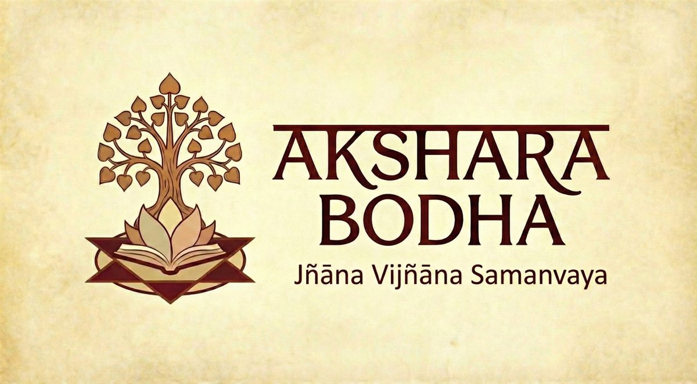
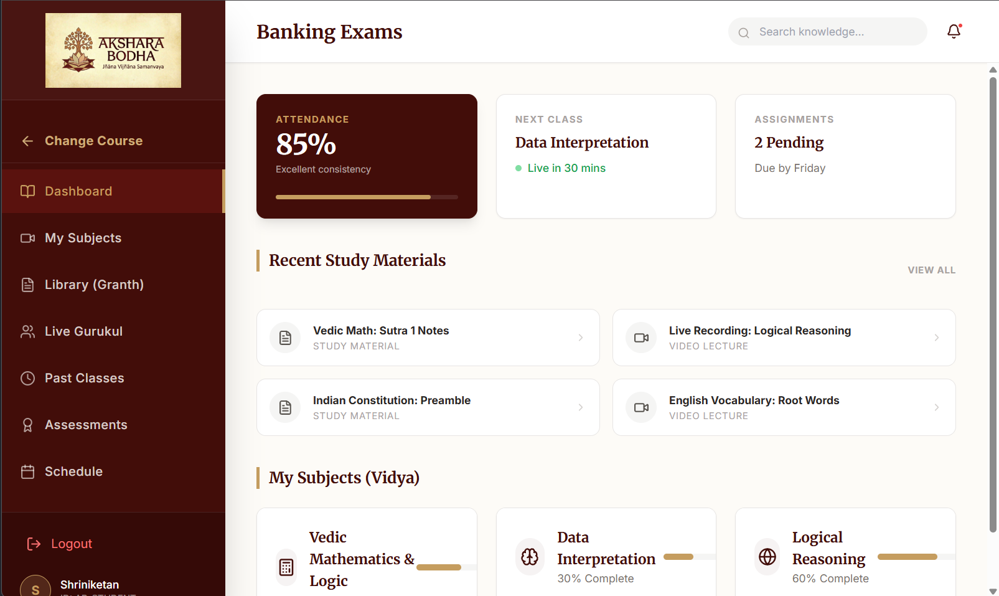
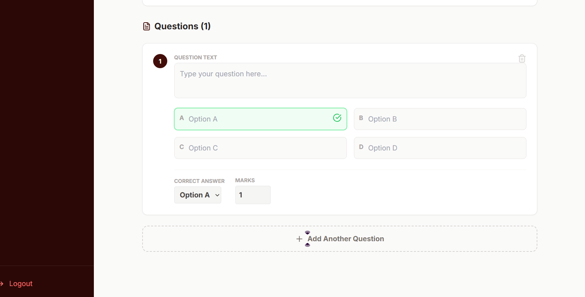

# Akshara Bodha

An exam-prep EdTech pilot I co-founded: a 140-student Telegram learning community, branded course decks and a three-sided learning platform (LMS) prototype for students, faculty and admins.

> **Showcase repo.** This repository holds the product story and screenshots only. AI coding tools wrote the prototype under my direction, and the code isn't published here.
> **Full case study:** https://shriniketan-portfolio.web.app/#/case/akshara-bodha-lms

## The problem

Students preparing for banking and other competitive exams (IBPS/SBI, SSC/Railways, PGCET, MAT) had their study material scattered across apps and chats. Faculty double-booked class slots, and admins couldn't see which classes actually ran. The idea came from using my own MBA university's online learning platform as a student.

## What I did

I co-founded it with a Quantitative Aptitude faculty partner, who taught. I ran the product and technical side:
- **Brand:** the name, logo and a "traditional wisdom, modern excellence" identity.
- **Course decks:** designed the presentation slides for the live classes.
- **Community:** grew a Telegram group to 140 students, with class recordings from Google Meet.
- **Pricing:** a ₹999 micro-batch, shown against a ₹5,000 reference price.
- **LMS prototype** with three roles:
  - Students: dashboard, materials, schedule, assessments.
  - Faculty: a slot picker that prevents double-booking, and a one-screen quiz builder.
  - Admins: approving the class schedule and monitoring live classes.

## The key product decision: scoping back the AI "Book Builder"

The original plan was one-click AI generation of full exam textbooks and question banks. Testing Gemini models on Google Cloud, I hit three problems:
- Long-form generation failed with every model I tried.
- I hadn't yet priced token cost against the ₹999 fee.
- One wrong step in a maths solution would cost students' trust.

I cut it down to a **Syllabus Discovery proof of concept** that finds chapters by subject and exam, and kept the content human-written.

## Outcome

- 140 students joined the Telegram community.
- I pitched the program to my employer's management. They declined, because it could compete with their own offline enrolment. As an employee, I held back the public launch rather than run a competing program without consent.
- **Status: on hold.** The LMS stayed a prototype and was never deployed.

## How it was built

- **My role:** product strategy, UX for three roles, brand, course-deck design, pricing, and community operations.
- **AI tools:** Google Antigravity.
- **Stack:** React/Vite, Tailwind CSS, Firebase Auth & Firestore, Gemini API on Google Cloud.

## Screenshots

**Student dashboard:** attendance, next class, pending assignments, materials and subject progress.

**Faculty quiz builder:** questions, options, correct answer and marks on one screen.

---

Built by [M I Shriniketan Joish](https://github.com/Shri0499) · [Portfolio](https://shriniketan-portfolio.web.app) · [LinkedIn](https://www.linkedin.com/in/shriniketan-joish-634599sj)
